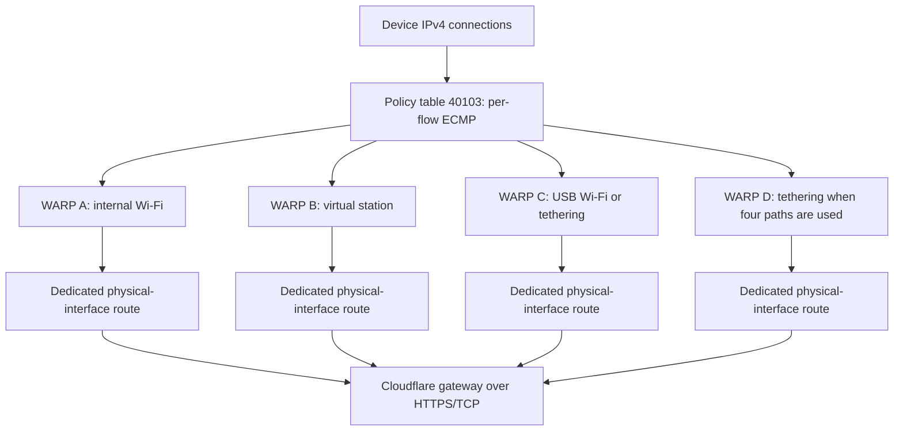

# Routing and lifecycle

Ordinary ECMP can distribute application connections across Wi-Fi interfaces. A single encrypted VPN tunnel collapses many of those connections into one outer transport flow. This tool distributes connections before encryption, using one independent WARP daemon for each uplink.

The manager discovers the internal Wi-Fi, USB Wi-Fi and USB Ethernet devices with NetworkManager and sysfs. It snapshots preceding connection UUIDs, creates `wlan-test` when absent, and clones the selected saved Wi-Fi profile for additional stations. Per-run profiles are restricted to their selected interfaces and are not set to autoconnect after reboot. New-network passwords are handled by `nmcli --ask`.

Each adapter must obtain an IPv4 address and default gateway before WARP setup proceeds. The manager starts the host WARP service as encrypted bootstrap DNS, preserving its previous mode and connection state for Off. Wi-Fi association stays under the host NetworkManager; physical Wi-Fi radios are not moved into namespaces.

The virtual station's per-run profile is pinned to the primary station's current access-point BSSID, with Wi-Fi power saving disabled for that profile. This reduces independent roaming between bands/access points on their shared radio. The BSSID is discovered on each On; no access-point address is hardcoded. The original saved profile is unchanged. If the primary station later roams, rerun Off/On to select its new access point. A dropped physical connection can remove its underlay routes; this version does not automatically rebuild them or remove failed paths from ECMP.

| Path | Namespace | Host veth | Private subnet | Underlay table | Underlay rule |
| --- | --- | --- | --- | --- | --- |
| A | `wdx-a` | `wdxh-a` | `10.203.41.0/30` | `40101` | `1101` |
| B | `wdx-b` | `wdxh-b` | `10.203.42.0/30` | `40102` | `1102` |
| C | `wdx-c` | `wdxh-c` | `10.203.43.0/30` | `40104` | `1103` |
| D | `wdx-d` | `wdxh-d` | `10.203.44.0/30` | `40105` | `1104` |

Interfaces are assigned to these logical slots at startup. C is USB Wi-Fi when present, or tethering when it is the third path; D is tethering in a four-path setup. No external physical-interface name is fixed in the manager.

Each namespace gets a veth connection to the host, private DNS bootstrap listeners, NAT, a physical-interface routing table and an unreachable fallback. Rules matching packets arriving from its host veth run before the device-wide policy. That pins the outer WARP connection to the chosen adapter and prevents it from recursively entering another tunnel.

Same-subnet uplinks also need ARP isolation. Without it, Linux can answer requests for a USB Wi-Fi address on the internal Wi-Fi, so return traffic converges on one adapter despite correct outgoing policy routes. Startup saves each selected interface's `arp_ignore` and `arp_announce`, sets them to `1` and `2`, and sends gratuitous ARP announcements with `arping` to refresh upstream neighbor entries. Off restores the saved values, skipping vanished interfaces. A local packet capture confirmed the incorrect USB-IP replies arriving on the internal NIC before this fix.

Each WARP daemon runs in its own transient systemd unit with private network and mount namespaces, independent registration state, a private `/run`, and private mounts for WARP state, logs and `/etc`. The private configuration directory prevents DNS recovery from exposing the host resolver files. The control helper checks the network and mount namespace identities before invoking `warp-cli`; two CLI processes alone would otherwise control the same host daemon.

The bootstrap creates the isolated instances and proxy-stage endpoints. The traffic stage changes them to `warp+doh`, waits for their `CloudflareWARP` interfaces, enables namespace forwarding and source NAT toward the tunnel, and verifies traffic. Normal device traffic then uses full IP tunnels, not an application proxy setting.

Inside each namespace, forwarding is allowed only from `eth0` to `CloudflareWARP` and for established return traffic. If the tunnel disappears, device traffic is dropped rather than forwarded unencrypted back to the host. This is fail-closed behavior for an affected path, not automatic failover to healthy paths.

After all selected tunnels are ready, rule `1150` selects table `40103`, with equal-weight next hops at each namespace's `.2` address. The host's `fib_multipath_hash_policy` is set to `1` to include transport ports in flow selection and is restored by Off when changed. Rules `1111`–`1114` preserve host access to the private veth subnets. Local-network, Tailscale-range and encrypted bootstrap-DNS exceptions continue through the original policy. The original main routing table is not replaced with a second physical ECMP configuration.

NetworkManager binds its Internet probes to physical adapters. The aggregate policy would otherwise make those probes fail and show a GNOME question mark, even while the WARP path works. `connectivity.py` resolves Fedora's configured public status host and adds narrow rules for adapter-bound requests to its IPv4 addresses. It performs a real connectivity recheck; it does not disable or falsify the checks. Off removes those owned probe rules, including when a USB interface has disappeared.

The setup checks for conflicting interfaces, subnets, tables, rule priorities and proxy-stage ports. It uses a process lock so On and Off cannot run concurrently. Before modifying networking it records state under the root-owned runtime directory. Startup failures clean up partial work. A stale manager manifest after reboot is cleaned up on the next invocation.

Namespace mounts disappear on reboot, while their `/etc/netns/wdx-*` configuration directories can remain. Startup reuses those directories and refreshes its DNS files after verifying that no live namespace conflicts. A leftover configuration directory alone does not block startup.

Off removes device-wide policy before stopping the tunnels, removes namespace and firewall additions, restores changed kernel settings, removes tool-created virtual adapters and cloned profiles, restores preceding physical connections and restores the host WARP state. Registrations and diagnostic snapshots remain in the private runtime directory for reuse. This private state must not be committed to a source repository.

Hardware lifecycle checks were performed locally for internal-pair, three-Wi-Fi and four-path USB-tethering operation. Those checks included starting with no virtual station, creating it automatically, successful `warp=on` checks per path, full NetworkManager IPv4 connectivity, and Off removing the namespaces, aggregate policy and created virtual station while restoring the original flow-hash setting. There is no timer that turns off a running setup.
